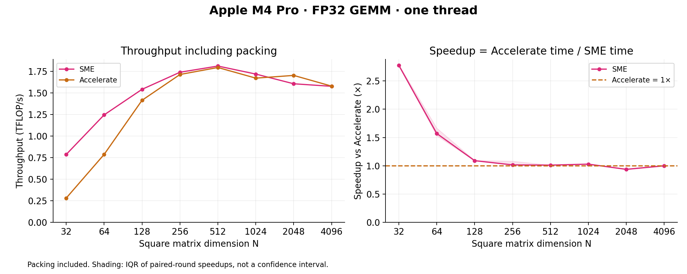

# apple-sme-gemm

A focused comparison of **SME** and **Apple Accelerate** for square FP32 matrix
multiplication on Apple M4 Pro. The repository contains one final SME
implementation, its packing code, the Accelerate wrapper, and the tools needed
to verify and measure them.



## Run

Requires macOS 15+, Apple Silicon with SME2 and 512-bit streaming vectors,
Command Line Tools supporting `apple-m4` (tested with Apple Clang 17), and
Python 3.10+. Building, testing and benchmarking use system tools and the Python
standard library. Matplotlib is needed only for plots.

```sh
python3 build.py
python3 check.py
python3 benchmark.py --suite full --output results/run1
python3 plot.py results/run1
```

Install the optional plotting dependency with:

```sh
python3 -m venv .venv
.venv/bin/python -m pip install -r requirements.txt
.venv/bin/python plot.py results/run1
```

The output directory must not already exist. For a short run:

```sh
python3 benchmark.py --suite quick --rounds 2 --samples 5 --min-sample-ms 20 --output results/quick
```

The Makefile provides `make test`, `make bench plot OUT=results/run1`, and
`make quick plot OUT=results/quick`. Set `PYTHON=.venv/bin/python` when needed.

## Two backends

| Backend | Implementation |
| --- | --- |
| `sme` | Final size-dependent SME2 implementation: ZA transpose of A; direct row-major B through N=512; otherwise 16×64 tiles, grouped B loads, A16/B64 packing, and KC=2048 / MC=256 / NC=512 blocking |
| `accelerate` | `cblas_sgemm`, explicitly configured and checked for single-thread execution |

Both compute **C = A × B** from square row-major FP32 inputs, with alpha=1 and
beta=0. Supported dimensions are multiples of 32 in [32,8192]. The small 32×32
and large 16×64 kernels are complementary paths within the same SME backend.
There are no experimental backends or calls from SME into Accelerate.

For a large N that is not divisible by 64, the final B panel contains 32 zero
columns. The same 16×64 kernel skips C loads/stores for nonexistent columns;
A and C retain their original dimensions. B packing uses 32-row × 256-column
chunks. The arithmetic loop consumes each four-vector tuple in its own K
iteration and is unrolled four times.

`src/gemm.h` defines the interface, constants, and packed-B workspace size.
`src/sme.c` implements SME; `src/pack.c` prepares its inputs;
`src/accelerate.c` wraps BLAS. `main.c` owns timing and numerical verification.

## What is measured

Every timed call includes required packing and the complete product. Allocation,
initialization, startup, calibration and verification are outside the timer.
There is one calling thread; Accelerate BLAS is forced to one thread.

- **Throughput:** `2*N³ / seconds / 10¹²`, reported in TFLOP/s in plots.
- **Speedup:** `Accelerate_time / SME_time`; above 1 means SME is faster.
- Speedups pair median timings within each round, then take the median ratio.
  Shading is the interquartile range across rounds, not a confidence interval.
  Throughput instead uses the pooled timing median; ratios can differ slightly.

The full suite uses N=32,64,128,256,512,1024,2048,4096, three randomized rounds,
and seven samples per case: **48 jobs and 336 samples**. Each sample averages
a batch calibrated to at least approximately 30 ms. Inputs are reused. The
measurements describe steady-state work, not individual-call tail latency,
cold-cache behavior, or maximum chip-wide multicore throughput. macOS controls
scheduling; keep power mode and competing workloads consistent.

Accelerate is a vendor library reference; its internal instruction path is not
inspected. This comparison includes packing and algorithm choices, so it does
not isolate the effect of the SME instruction set.

## Results and checks

[`examples/m4-pro/`](examples/m4-pro/) contains a complete fresh run of the
current code: raw jobs, timing samples, summary and paired-speedup CSVs,
verification results, hardware/compiler metadata, source/binary hashes, and
PNG/SVG/PDF plots. The build and runner reject stale sources or binaries.

`check.py` uses AddressSanitizer and UndefinedBehaviorSanitizer. It checks every
packed value and padded B value at 15 dimensions, then checks both backends at
15 dimensions with two seeds, repeated output overwrites, output guards and
an independent scalar double reference. Numerical checks cover all entries
through N=192 and 512 entries at larger sizes, including explicit edge coverage.
Benchmark jobs also verify output before and after sampling.

The [cleanup validation](validation/cleanup/README.md) compares this code with
the previously published optimized implementation using interleaved runs.
Across the eight standard sizes, paired SME speedups were **0.996×–1.009×**.
The two measured 32-column-tail cases improved. This is measured comparability
on this machine, rather than a universal statistical equivalence claim.

For custom dimensions or numerical checks without timing:

```sh
python3 benchmark.py --sizes 96,544,2080,8192 --verify-only --output results/checks
python3 benchmark.py --sizes 512,1024 --output results/custom
python3 benchmark.py --suite full --dry-run
```

## Slides

[`slides/`](slides/) contains a 15-slide English explanation of SME, the final
packing/kernel design, and its measured comparison with Accelerate:
[PDF](slides/sme-on-apple-m4-pro.pdf),
[editable PowerPoint](slides/sme-on-apple-m4-pro.pptx), and speaker notes.
See [slides/README.md](slides/README.md) for rebuilding from existing results.
